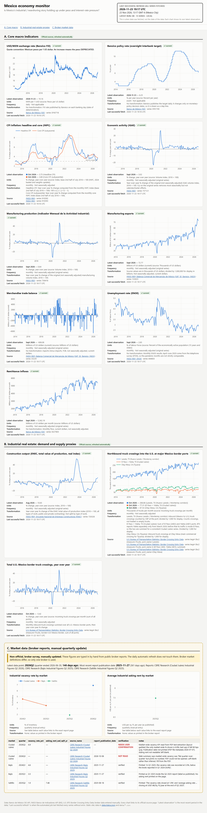

# Mexico economy monitor

A static, self-updating dashboard for one question:

> **Is Mexico's industrial / nearshoring story holding up under peso and interest-rate pressure?**

* **Panel A: core macro.** Peso, policy rate, inflation, activity, manufacturing, trade, jobs, remittances. Official sources, refreshed daily.
* **Panel B: industrial real estate demand and supply proxies.** Construction output and cross-border truck traffic. Official sources, refreshed daily.
* **Panel C: broker market data.** Industrial vacancy and asking rents from one broker. **Non-official and entered by hand** every quarter.

Everything is driven by [`config/series.yaml`](config/series.yaml). Python fetches the data into `data/`, a plain HTML/JS page
(Plotly.js) draws it, GitHub Actions refreshes it daily, and GitHub Pages hosts it. There is no server.



## Series

All IDs were looked up in the official catalogs: the Banxico SIE table pages and the INEGI BIE indicator search.
Each was then fetched through the API, and its name and units were checked against the API metadata
(Banxico `/series/{id}`, INEGI `CL_INDICATOR` / `CL_UNIT`). Monthly CSV dates are the first day of the month.

### Panel A: core macro (official, automated)

| Series (dashboard id) | Units (as published) | Freq. | Source | Series ID | Transformation shown |
|---|---|---|---|---|---|
| USD/MXN FIX (`usdmxn_fix`) | Pesos per US dollar | daily (banking days) | Banco de México SIE, [table CF102](https://www.banxico.org.mx/SieInternet/consultarDirectorioInternetAction.do?sector=6&accion=consultarCuadro&idCuadro=CF102&locale=es) | `SF43718` | none |
| Policy rate: target for overnight interbank rate (`policy_rate`) | % per year | event-driven (published daily) | Banco de México SIE, [table CF101](https://www.banxico.org.mx/SieInternet/consultarDirectorioInternetAction.do?sector=18&accion=consultarCuadro&idCuadro=CF101&locale=es) | `SF61745` | none; step line |
| Headline CPI (`inpc_headline`) | Index, 2nd half July 2018 = 100 (2024 basket and weights update) | monthly | INEGI BIE, [INPC](https://www.inegi.org.mx/programas/inpc/2018/) | `910392` | y/y % from index |
| Core CPI (`inpc_core`) | Index, 2nd half July 2018 = 100 | monthly | INEGI BIE, [INPC](https://www.inegi.org.mx/programas/inpc/2018/) | `910393` | y/y % from index |
| IGAE, total (`igae`) | Volume index 2018 = 100, original (NSA) | monthly | INEGI BIE, [IGAE](https://www.inegi.org.mx/programas/igae/2018/) | `737121` | y/y % |
| Manufacturing, SCIAN 31-33 (`manufacturing_ip`) | Volume index 2018 = 100, original (NSA) | monthly | INEGI BIE, [IMAI](https://www.inegi.org.mx/programas/aim/2018/) | `736418` | y/y % |
| Manufacturing exports incl. maquila (`mfg_exports`) | Thousands of US$, NSA, current | monthly | INEGI BIE, [Balanza comercial](https://www.inegi.org.mx/programas/comext/) | `133023` | shown in US$ billions (÷1,000,000) |
| Merchandise trade balance, FOB (`trade_balance`) | Millions of US$, NSA, current | monthly | INEGI BIE, [Balanza comercial](https://www.inegi.org.mx/programas/comext/) | `33229` | none |
| Unemployment rate (`unemployment`) *(optional 7th)* | % of EAP aged 15+, NSA | monthly | INEGI BIE, [ENOE](https://www.inegi.org.mx/programas/enoe/15ymas/) | `444603` | none |
| Remittance inflows (`remittances`) *(optional 8th)* | Millions of US$, NSA | monthly | Banco de México SIE, [table CE81](https://www.banxico.org.mx/SieInternet/consultarDirectorioInternetAction.do?sector=1&accion=consultarCuadro&idCuadro=CE81&locale=es) | `SE27803` | none |

**Exchange-rate convention.** The FIX is quoted as **Mexican pesos per 1 US dollar**. A rise means the peso
**depreciated**. The chart says so.

**Why NSA y/y.** For IGAE and manufacturing, year-over-year changes are computed on INEGI's *original* (not seasonally
adjusted) indices, which matches the "cifras originales" annual rates in INEGI's press releases. Y/y on original
data removes most seasonality but not calendar or Easter effects. INEGI's seasonally adjusted series are revised
every month, so using them would move history more often.

**CPI base.** INEGI updated the INPC basket and weights in 2024 but kept the base period (2nd half of July 2018 = 100).
IDs `910392` / `910393` are the current, chained series in the "Actualización de Canasta y Ponderadores 2024" branch of BIE.

### Panel B: industrial real estate proxies (official, automated)

| Series (dashboard id) | Units | Freq. | Source | Series ID | Transformation |
|---|---|---|---|---|---|
| ENEC value of production, total (`enec_production`) | Index 2018 = 100 (real), NSA | monthly | INEGI BIE, [ENEC](https://www.inegi.org.mx/programas/enec/2018/) | `720326` | y/y % |
| Truck crossings: Laredo, TX (`trucks_laredo`) | Inbound trucks / month | monthly | U.S. BTS [Border Crossing Entry Data](https://data.bts.gov/Research-and-Statistics/Border-Crossing-Entry-Data/keg4-3bc2) | `keg4-3bc2`, port Laredo | ÷1,000 for display |
| Truck crossings: El Paso + Ysleta, TX (`trucks_el_paso`) | Inbound trucks / month | monthly | U.S. BTS | `keg4-3bc2`, ports El Paso (2402) + Ysleta (2401) | sum of ports; ÷1,000 |
| Truck crossings: Otay Mesa, CA (`trucks_otay_mesa`) | Inbound trucks / month | monthly | U.S. BTS | `keg4-3bc2`, port Otay Mesa | ÷1,000 |
| Truck crossings: all U.S.-Mexico ports (`trucks_border_total`) | Inbound trucks / month | monthly | U.S. BTS | `keg4-3bc2`, border = US-Mexico | y/y % of the sum |

**Why these proxies.**

* **ENEC (construction): chosen.** It is the official monthly construction survey, has an API, and goes back to 2006.
  ENEC does publish value of production by type of work in BIE (e.g. edificación, transporte y urbanización),
  but on request the panel uses the **total** (all types of work, public and private contracting). This keeps it
  as one consistent supply-side series. The by-type indices (e.g. `720340`, transporte y urbanización) can be
  added later with a YAML edit. INEGI's quarterly national-accounts series "Edificación de naves y plantas
  industriales" (`743928`) is quarterly and lags more, so it was not used.
* **BTS truck crossings: chosen.** This is a monthly U.S. government count with a no-token API, back to 1996. The three
  ports chosen map to the main industrial markets: Laredo to Monterrey/Nuevo León, El Paso/Ysleta to Ciudad Juárez,
  and Otay Mesa to Tijuana. They are demand proxies for manufacturing and logistics space.
* **IMSS formal manufacturing employment: not used.** IMSS publishes employer-level monthly microdata files on
  datos.imss.gob.mx, not an aggregated API. During setup the portal's dataset API did not return a usable response.
  A robust job would have to download and aggregate a very large file every month. This is worth adding later as a
  separate pipeline.
* **FDI by sector/state (Secretaría de Economía): not used.** It is quarterly, published as files whose URLs change
  with each release, and has no stable API.

### Panel C: broker data (manual, NOT official)

The panel uses **one broker: CBRE Research's "Industrial Figures" reports** (<https://www.cbre.com.mx/reportes-de-mercado>).
CBRE publishes public quarterly pages for **Ciudad Juárez, Bajío and Saltillo**, so those are the three markets.
Two other brokers were checked:

* **Cushman & Wakefield.** Its public Mexico industrial MarketBeats covered only Monterrey (latest Q3 2025) and Mexico City.
* **Newmark.** Its pages refused automated access.

Values and their status are in [`data/manual/market_data.csv`](data/manual/market_data.csv).
See [`docs/UPDATING_MARKET_DATA.md`](docs/UPDATING_MARKET_DATA.md) for how to add a quarter. Two caveats:

* The Juárez Q2 2026 vacancy (6.9%) is flagged **NEEDS USER CONFIRMATION**.
* The Juárez Q3 2026 vacancy is blank, because the report text only says "flat".

## Data files

* `data/<id>.csv` has columns `date,value[,yoy_pct]`. `value` is the number exactly as the source publishes it. The derived column
  is added only when the series has a transformation.
* `data/status.json` holds, for each series: `latest_observation_date`, `last_fetch_attempt_utc`,
  `last_successful_fetch_utc`, `status` (ok/error), `error`, plus the series metadata the front end displays.
  Top-level fields are `last_successful_refresh_utc` and `last_run`, which records the status of the latest run (ok/partial/failed).
* `data/manual/market_data.csv` holds the Panel C broker data, edited by hand.

### Failure behaviour

* If a series fails (HTTP error, bad token, empty or shrunken response, wrong series ID returned), its previous
  CSV is **kept**. Its `last_successful_fetch_utc` and `latest_observation_date` are **not** changed. It is
  marked `status: "error"` with the message, and the chart shows a red **STALE** badge with the reason.
* The other series are still written and published. The workflow fails only if *every* series fails.
* `last_successful_refresh_utc` advances only when a **full** run succeeds for **every** series. After a partial run,
  the header shows the older timestamp plus a red "latest run: PARTIAL" note.
* A series also shows **STALE** when `today - latest_observation_date > stale_after_days`. That threshold is set per series
  as the period length plus the source's normal publication lag plus about 10 days of grace. For example, IGAE
  is published about 52 days after the month ends, so its threshold is 125 days.
* Panel C is never touched by the refresh. `status.json` records `auto_refreshed: false` for it, and the panel shows
  the age of its latest data point in days.

## Run locally

```bash
python -m venv .venv
# Windows: .venv\Scripts\activate    macOS/Linux: source .venv/bin/activate
pip install -r requirements.txt
cp .env.example .env        # then paste your tokens into .env (never commit it)
python src/fetch.py         # refresh all series; appends to verify/refresh_log.txt
python src/fetch.py --only igae,inpc_core   # refresh a subset (does not move last_successful_refresh_utc)
python verify/check.py      # spot checks vs. original sources
python -m http.server 8000  # then open http://localhost:8000
```

Tokens:

* **Banxico SIE**: <https://www.banxico.org.mx/SieAPIRest/service/v1/token>. Store it as `BANXICO_TOKEN`.
* **INEGI**: <https://www.inegi.org.mx/app/desarrolladores/generatoken/Usuarios/token_Verify>. Store it as `INEGI_TOKEN`.
* **BTS**: no token needed. `BTS_APP_TOKEN` is optional and only raises rate limits.

Screenshot (optional dev dependency):

```bash
pip install playwright && python -m playwright install chromium
python verify/screenshot.py   # writes verify/dashboard.png
```

## Scheduling and hosting

[`.github/workflows/refresh.yml`](.github/workflows/refresh.yml) runs **daily at 19:00 UTC (13:00 Mexico City)**, after
Banxico publishes the FIX at about 12:00. You can also run it by hand from the Actions tab (`workflow_dispatch`). It:

1. installs Python 3.11 and the requirements,
2. runs `src/fetch.py` with tokens from repository secrets,
3. runs `verify/check.py` (informational),
4. commits `data/` and `verify/refresh_log.txt` back to the repo,
5. deploys the repository root to GitHub Pages.

One-time setup on GitHub:

1. Create a repository and push this folder.
2. Go to *Settings > Secrets and variables > Actions* and add `BANXICO_TOKEN` and `INEGI_TOKEN`.
3. Go to *Settings > Pages > Build and deployment* and set the source to **GitHub Actions**.
4. Go to *Actions > "Refresh data and publish dashboard"* and click *Run workflow*.

## Adding a series (YAML only)

1. Find the series ID in the official catalog:
   * **Banxico**: the SIE table pages. The ID looks like `SFxxxxx` or `SExxxxx`.
   * **INEGI**: the [BIE indicator search](https://www.inegi.org.mx/app/indicadores/?tm=3). Search by name or by key.
   * **BTS**: dataset filters.
2. Add an entry under `series:` in `config/series.yaml`. Copy a similar series and change `id`, `name`,
   `source_series_id`, `endpoint`, `units`, `transform`, `source_url`, `stale_after_days` and so on. Either point `chart:`
   at an existing chart (at most 3 series per chart), or add a new entry under `charts:` with `panel: A` or `panel: B`.
3. Run `python src/fetch.py --only <new_id>` and check the log line and `data/<new_id>.csv`.
4. Add a row to `verify/spot_checks.csv` with a value read from the official page, then run `python verify/check.py`.

Supported `api` values are `banxico`, `inegi` and `bts`. Supported `transform` values are `none` and `yoy_pct`.
New APIs or transforms are one small function each in `src/sources.py` / `src/transforms.py`.

## Verification

* [`verify/spot_checks.csv`](verify/spot_checks.csv) has 22 checks, at least one per series and per Panel C market.
  Each check records the value read from the **original publication**: Banxico's FIX page and home page, INEGI's
  press releases, Banxico's remittance release, and CBRE's report pages. These sources are independent of the APIs.
* [`verify/check.py`](verify/check.py) compares them using a stated tolerance rule: **half a unit of the last digit the source
  prints**. Sources round, and the dashboard keeps full precision.
* **Result: 17 PASS, 0 FAIL, 5 PENDING.** The pending ones are intentionally blank and must be filled by hand:
  * the four BTS truck checks. The only machine-readable source is the same API the dashboard uses, so a human should read the values off the BTS data page;
  * Juárez Q2 2026 vacancy. It was read from garbled PDF text, so please confirm it.
* **Disagreements:** none beyond rounding. Every difference is within half a unit of the source's last printed digit.
  Examples: IGAE y/y 3.018 vs 3.0 printed, manufacturing y/y 0.641 vs 0.6, ENEC index 87.95 vs 88.0.
  * **Revisions.** INEGI revises recent months (IGAE, IMAI, ENEC, trade) when it adds new data. A spot check recorded
    today can later differ by more than rounding. That is a revision, not an error: re-read the source and update the row.
  * **Seasonal adjustment.** Every dashboard series is the **original (NSA)** series. INEGI's press-release headlines are
    usually seasonally adjusted, so compare against the "cifras originales" tables, as the spot checks do.
* [`verify/refresh_log.txt`](verify/refresh_log.txt) is appended to by every run (local and Actions) and keeps the last 30 runs.
* [`verify/dashboard.png`](verify/dashboard.png) is the Playwright screenshot.
* [`verify/simulate_failure.py`](verify/simulate_failure.py) simulates an outage for one series. It was run on 2026-11-23:
  IGAE was marked `error`, its CSV and `last_successful_fetch_utc` were kept, the global `last_successful_refresh_utc`
  did not move, and the run was recorded as `partial`. [`verify/dashboard_failure_demo.png`](verify/dashboard_failure_demo.png)
  shows the resulting red STALE badge and PARTIAL warning. A normal refresh was run afterwards.
* **Not yet done: the GitHub Actions run.** It needs the repository to be pushed to GitHub with the secrets set
  (see *Scheduling and hosting*). Each Actions run appends its log, tagged `GitHub Actions run <id>`, to `verify/refresh_log.txt`.

## Known data quirks

* **BTS Ysleta.** Ysleta (port 2401) appears in BTS only from March 2020. Before that its trucks are counted under El Paso
  (2402), so the Juárez series sums both.
* **BTS Otay Mesa.** Otay Mesa has no November 2021 row in the BTS data. Its y/y comparisons skip that month instead of using a wrong one.
* **ENOE.** The April–June 2020 figures come from INEGI's telephone survey (ETOE), not the regular ENOE, so they are not strictly comparable.
